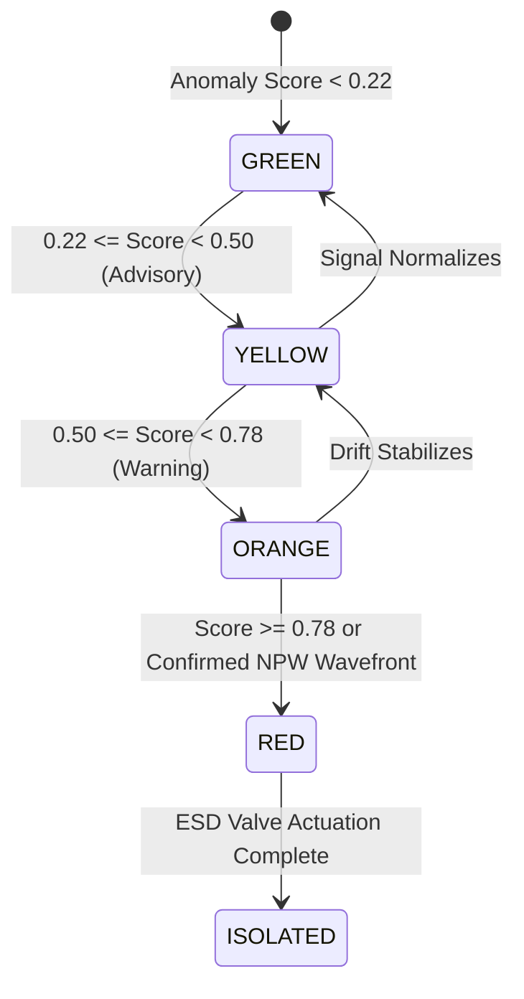

# Module 02: Edge Analytics & Detection Algorithms

## 1. Overview of the Edge Signal Processing Pipeline

The DeepGuard Edge Analytics Engine runs continuous, low-latency signal processing over high-frequency sensor streams (20 Hz sampling rate). The pipeline transforms noisy pressure and flow readings into actionable health classifications and emergency isolation commands.

```
Raw Sensor Stream (20 Hz)
   |
   +---> [ 1. Numerical Derivative dP/dt ] ---> Negative Wavefront Onset Detection
   |
   +---> [ 2. Dynamic Mass Balance ]       ---> ΔM = Q_in - Q_out
   |
   +---> [ 3. Rolling Variance (std) ]     ---> Turbulent Ocean Noise Filtering
   |
   +---> [ 4. Baseline Deviation ]         ---> ΔP_baseline drop
   |
   v
[ Composite Anomaly Scorer (0.0 - 1.0) ]
   |
   +---> Health State Machine (GREEN / YELLOW / ORANGE / RED)
   |
   +---> Per-Segment Health Attribution (S1 - S5)
   |
   +---> Virtual ESD Isolation Trigger (Auto-shutdown when Score >= 0.75)
```

---

## 2. Wavefront Arrival Onset Detection Algorithm

The arrival of a negative pressure wave is characterized by a sudden, sharp negative inflection in the pressure time-series ($P(t)$). To avoid false alarms from regular pump oscillations or ocean swell pressure changes, we apply numerical differentiation and slope thresholding:

### Step 1: Discrete Gradient Calculation
$$\left. \frac{dP}{dt} \right|_{t_k} = \frac{P(t_k) - P(t_{k-1})}{\Delta t}$$

### Step 2: Steepest Drop & Onset Backtracking
1. Locate minimum negative gradient:
   $$\text{idx}_{\text{min}} = \arg \min_k \left( \frac{dP}{dt} \right)$$
2. Validate against threshold:
   $$\left. \frac{dP}{dt} \right|_{\text{idx}_{\text{min}}} < -0.45\text{ bar/s}$$
3. **Onset Backtracking**: The exact physical arrival of the wave front is not the peak slope, but the initial departure from the steady baseline. We step backward from $\text{idx}_{\text{min}}$ until:
   $$\left. \frac{dP}{dt} \right|_{\text{onset}} \ge 0.3 \times \left( \left. \frac{dP}{dt} \right|_{\text{idx}_{\text{min}}} \right)$$
4. The timestamp at $\text{onset}$ is registered as $t_{\text{inlet}}$ or $t_{\text{outlet}}$.

---

## 3. Dynamic Mass Balance Equation

Under steady-state operations without leaks, the mass entering the pipeline equals the mass exiting, minus the rate of change in fluid inventory (line pack):
$$\Delta M(t) = Q_{\text{in}}(t) - Q_{\text{out}}(t) - \frac{dM_{\text{pack}}}{dt}$$

Where line pack is related to mean pipeline pressure and fluid compressibility:
$$M_{\text{pack}} = V_{\text{pipe}} \cdot \bar{\rho} = \left(\frac{\pi D^2 L}{4}\right) \cdot \rho_0 \left[ 1 + \frac{\bar{P} - P_0}{K} \right]$$

When a rupture occurs:
$$\Delta M(t) = Q_{\text{leak}} > \text{threshold} \implies \text{Mass Imbalance Alert}$$

---

## 4. Multi-Factor Anomaly Scoring Function

The composite anomaly score $\mathcal{S} \in [0.0, 1.0]$ combines four independent physical indicators:

$$\mathcal{S} = \min \Big( 1.0, \; w_1 \cdot \mathcal{F}_{\text{grad, in}} + w_2 \cdot \mathcal{F}_{\text{grad, out}} + w_3 \cdot \mathcal{F}_{\text{flow}} + w_4 \cdot \mathcal{F}_{\text{drop}} \Big)$$

Where:
- $\mathcal{F}_{\text{grad, in}} = \max\left(0, -\frac{dP_{\text{in}}/dt}{4.0}\right)$ (Weight $w_1 = 0.30$)
- $\mathcal{F}_{\text{grad, out}} = \max\left(0, -\frac{dP_{\text{out}}/dt}{4.0}\right)$ (Weight $w_2 = 0.30$)
- $\mathcal{F}_{\text{flow}} = \text{clamp}\left(\frac{(Q_{\text{in}} - Q_{\text{out}}) - 15.0}{75.0}, 0, 1\right)$ (Weight $w_3 = 0.40$)
- $\mathcal{F}_{\text{drop}} = \max\left(0, \frac{P_{\text{base}} - P}{25.0}\right)$ (Weight $w_4 = 0.20$)

---

## 5. Four-Tier Health State Machine



| State | Score Range | Color Code | Operational Meaning | Action Triggered |
|---|---|---|---|---|
| **GREEN** | $0.00 \le \mathcal{S} < 0.22$ | `#10b981` | Optimal steady flow within envelope | Normal telemetry logging |
| **YELLOW** | $0.22 \le \mathcal{S} < 0.50$ | `#f59e0b` | Minor pressure fluctuation / transient | Advisory flag; increased telemetry focus |
| **ORANGE** | $0.50 \le \mathcal{S} < 0.78$ | `#f97316` | Persistent pressure drop / micro-leak | Warning tone; AUV dispatched to sector |
| **RED** | $\mathcal{S} \ge 0.78$ | `#ef4444` | Confirmed rupture / NPW wavefront arrival | **Emergency Shutdown (ESD) auto-triggered** |

---

## 6. Segment Health Attribution (5 Segments)

The 10 km pipeline is partitioned into 5 monitored sections:
1. **Segment 1**: $0\text{ m} - 2,000\text{ m}$ (Inlet Riser) — Valves `V0` & `V1`
2. **Segment 2**: $2,000\text{ m} - 4,000\text{ m}$ (Shallow Bathymetry) — Valves `V1` & `V2`
3. **Segment 3**: $4,000\text{ m} - 6,000\text{ m}$ (Abyssal Trench) — Valves `V2` & `V3`
4. **Segment 4**: $6,000\text{ m} - 8,000\text{ m}$ (Continental Shelf Slope) — Valves `V3` & `V4`
5. **Segment 5**: $8,000\text{ m} - 10,000\text{ m}$ (Outlet PLEM Manifold) — Valves `V4` & `V5`

When $X$ is resolved by the NPW engine:
$$\text{Segment ID} = \min\left(5, \; \lfloor X / 2000.0 \rfloor + 1\right)$$
The corresponding upstream valve $V_{\text{id}-1}$ and downstream valve $V_{\text{id}}$ are signaled for immediate hydraulic closure.

