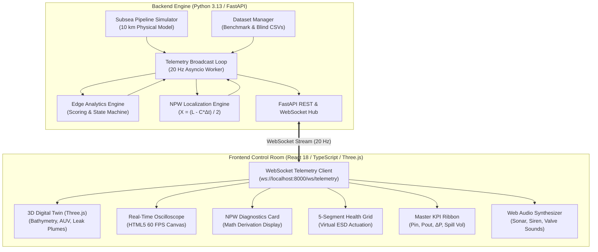

# Module 03: System Architecture & Data Flow

## 1. High-Level Architectural Diagram



---

## 2. Sequence Diagram: Detect → Localize → Visualize → Respond

```mermaid
sequenceDiagram
    autonumber
    actor Operator as Operator / Judge
    participant Sim as Simulator
    participant Edge as Edge Analytics
    participant NPW as NPW Engine
    participant WS as WebSocket Hub
    participant UI3D as 3D Digital Twin
    participant Valves as Sector ESD Valves

    Operator->>Sim: Inject Leak (e.g. at 3,450 m, 25% severity)
    Sim->>Sim: Propagate acoustic wave at C = 1,150 m/s
    Sim-->>Edge: Wave reaches inlet at t1 = 3.00s, outlet at t2 = 5.70s
    Edge->>Edge: Detect dP/dt < -0.45 bar/s inflection
    Edge->>NPW: Trigger Wavefront Analysis with Δt = 2.70s
    NPW->>NPW: X = (10,000 - 1,150 * 2.70) / 2 = 3,450 m (Seg 2)
    NPW-->>WS: Broadcast Rupture Alert + Localized Metric
    WS-->>UI3D: Render 3D Breach Plume at X = 3,450 m
    WS-->>UI3D: Shift Segment 2 Color from Green to RED
    WS->>Valves: Auto-Trigger ESD Isolation on Segment 2
    Valves->>Valves: Close V1 (2.0 km) and V2 (4.0 km)
    Sim->>Sim: Choke leak discharge; spill volume capped
    WS-->>Operator: Audit Trail Alert & Audio Siren Dispatched
```

---

## 3. Backend Component Breakdown

| Module | File | Core Responsibilities |
|---|---|---|
| **NPW Engine** | [`npw_engine.py`](file:///Users/ankityadav/Desktop/Zin/backend/npw_engine.py) | Implements $X = (L - C \cdot \Delta t)/2$, discrete inflection onset backtracking, wave arrival cross-correlation, and segment attribution. |
| **Edge Analytics** | [`edge_analytics.py`](file:///Users/ankityadav/Desktop/Zin/backend/edge_analytics.py) | Ingests 20 Hz telemetry, evaluates mass balance $\Delta M$, computes rolling variances, scores anomalies, and manages 4-tier health states. |
| **Pipeline Simulator** | [`simulator.py`](file:///Users/ankityadav/Desktop/Zin/backend/simulator.py) | 10 km physical hydraulics simulation with Darcy head loss, pressure wave arrival physics, Torricelli leak outflow, and valve stroke dynamics. |
| **Dataset Manager** | [`dataset_manager.py`](file:///Users/ankityadav/Desktop/Zin/backend/dataset_manager.py) | Generates benchmark CSV datasets, loads CSV playback streams, and conducts dynamic blind CSV evaluation without hardcoding. |
| **FastAPI Controller** | [`main.py`](file:///Users/ankityadav/Desktop/Zin/backend/main.py) | REST API endpoints, 20 Hz background telemetry broadcaster, audit event ledger, and WebSocket connection pool. |

---

## 4. Frontend Component Breakdown

| Component | File | Core Responsibilities |
|---|---|---|
| **Digital Twin 3D** | [`DigitalTwin3D.tsx`](file:///Users/ankityadav/Desktop/Zin/frontend/src/components/DigitalTwin3D.tsx) | WebGL Three.js subsea world, custom bathymetric terrain, 5-segment glowing pipe meshes, dynamic bubble/oil plume particles, AUV sub, and camera presets. |
| **Pressure Charts** | [`PressureCharts.tsx`](file:///Users/ankityadav/Desktop/Zin/frontend/src/components/PressureCharts.tsx) | 60 FPS HTML5 Canvas oscilloscope with 3 modes: $P(t)$ Inlet/Outlet, $dP/dt$ wavefront gradient spikes, and 10 km spatial gradient profiles. |
| **NPW Diagnostics** | [`NpwDiagnosticsCard.tsx`](file:///Users/ankityadav/Desktop/Zin/frontend/src/components/NpwDiagnosticsCard.tsx) | Mathematical callout displaying $X = (L - C \cdot \Delta t)/2$ live, calculated $t_1, t_2, \Delta t$, confidence percentage, and sector attribution. |
| **Segment Health Grid** | [`SegmentHealthGrid.tsx`](file:///Users/ankityadav/Desktop/Zin/frontend/src/components/SegmentHealthGrid.tsx) | 5 Segment cards (2 km each) with real-time pressure, status indicators, valve status, and manual virtual ESD isolation switches. |
| **KPI Ribbon** | [`KpiRibbon.tsx`](file:///Users/ankityadav/Desktop/Zin/frontend/src/components/KpiRibbon.tsx) | Top summary HUD for $P_{\text{in}}$, $P_{\text{out}}$, $\Delta P$, flow differential, localized $X$, cumulative spill, and system integrity status. |
| **Header** | [`Header.tsx`](file:///Users/ankityadav/Desktop/Zin/frontend/src/components/Header.tsx) | Branding, WebSocket latency indicator, UTC clock, audio mute toggle, master ESD button, and modal triggers. |
| **Simulation Controls** | [`SimulationControlsModal.tsx`](file:///Users/ankityadav/Desktop/Zin/frontend/src/components/SimulationControlsModal.tsx) | Custom leak distance slider ($0 - 10,000\text{ m}$), severity toggles, speed multipliers ($1\text{x}, 2\text{x}, 5\text{x}$), and benchmark loaders. |
| **Blind Testing Lab** | [`BlindTestingModal.tsx`](file:///Users/ankityadav/Desktop/Zin/frontend/src/components/BlindTestingModal.tsx) | Drag-and-drop CSV testing tool for judges, displaying dynamic extraction metrics and verification reports. |
| **Web Audio Synthesizer**| [`audio.ts`](file:///Users/ankityadav/Desktop/Zin/frontend/src/utils/audio.ts) | Web Audio API industrial audio synthesis (sonar pings, emergency sirens, hydraulic valve closure thuds). |

